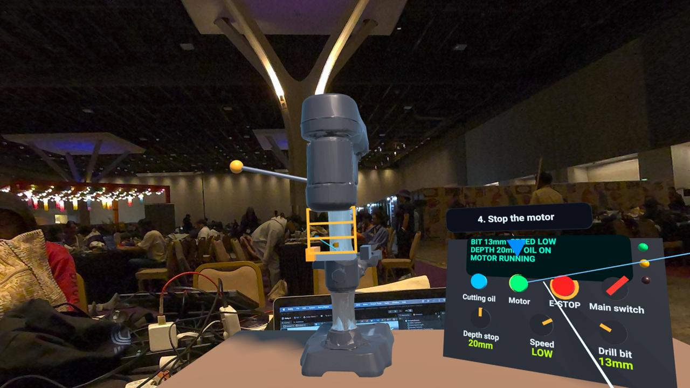
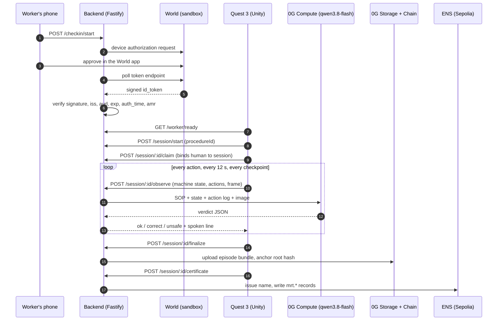
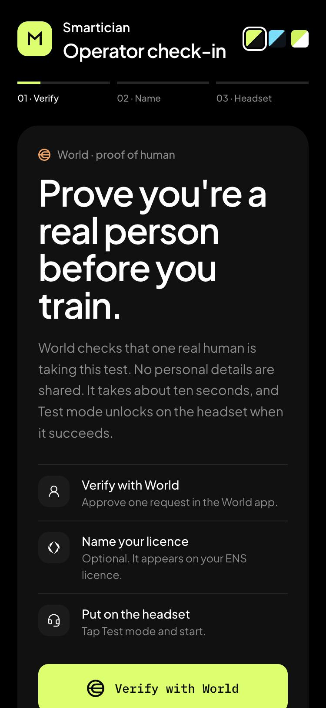
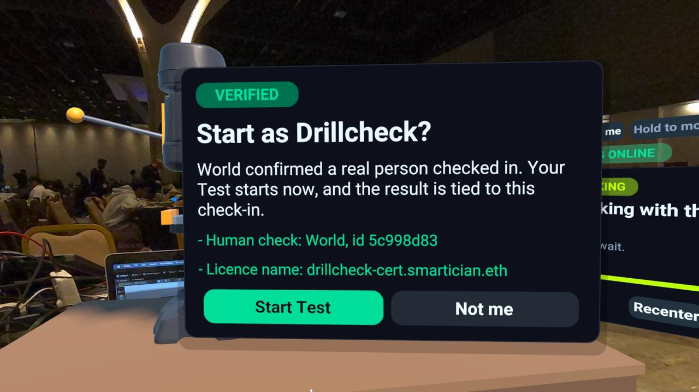
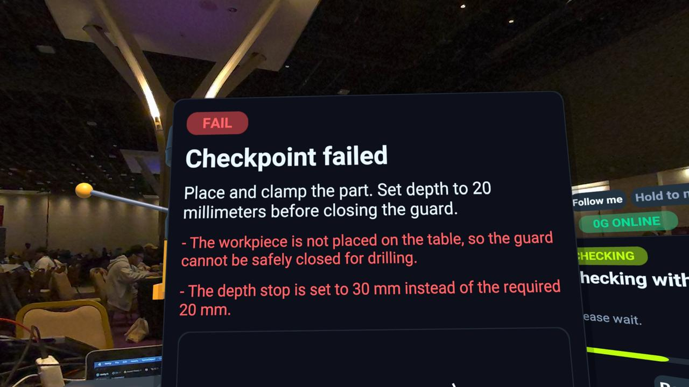
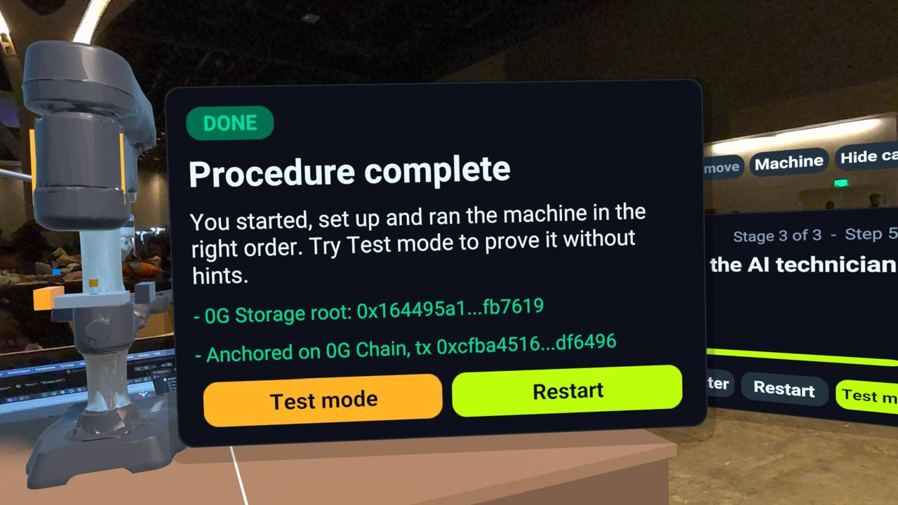
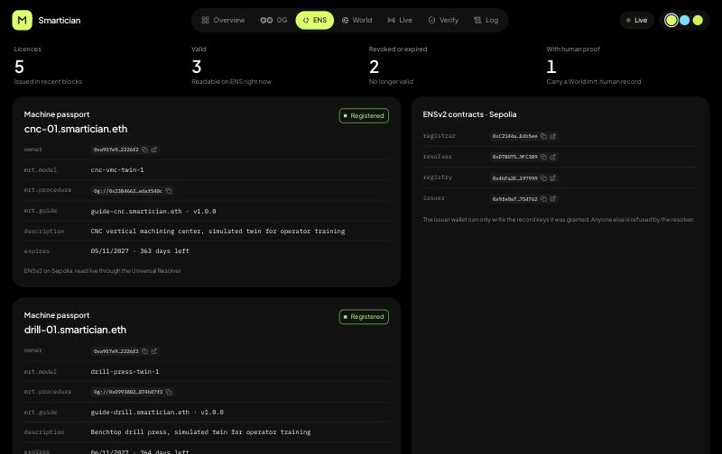
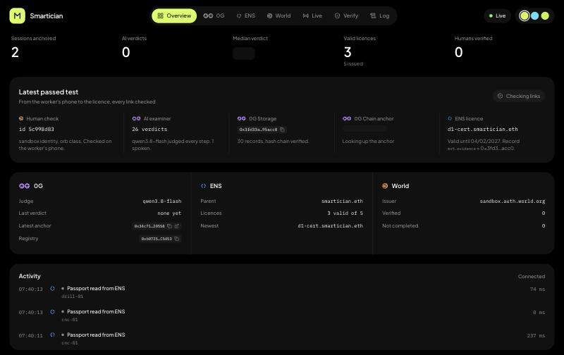

# Smartician

A mixed-reality operator trainer for the Meta Quest 3. A trainee learns, then is tested on, the start-up and operation of a real machine in a simulation. An AI technician running on 0G is the only judge of the test. A real human is proven before the test unlocks. A pass leaves a tamper-evident record on 0G and an expiring, revocable licence on ENS.

Two simulations ship today: a **CNC vertical machining centre** (22 steps) and a **benchtop drill press** (13 steps). They share one engine, one judge and one proof trail.

Live deployment: <https://eth2026.dakshkulkarni.in>



## How a licence is earned



### 1. Proof of human, on the phone

Test mode is locked on the headset until a real person has checked in. The worker opens the check-in page on their phone, taps **Verify with World**, and approves one request in the World app. No name pad exists in VR; the licence name is chosen on the phone.



The backend runs the OAuth 2.0 **device authorization grant** against World's sandbox issuer (`sandbox.auth.world.org`, `client_secret_basic`) and polls the token endpoint. The browser result is never trusted. When a token arrives, the server verifies it itself before marking the check-in verified:

- RS256 signature against the issuer's published JWKS
- `iss` and `aud` match this app's client, `exp` is in the future
- `auth_time` is fresh: not older than this attempt, not in the future
- `amr` is present; the assurance level (`acr`) is recorded

The verified identity is reduced to `sha256(issuer | sub)` and kept as an opaque human id. A transient network error while polling is a `retry`, not a failure, so a dropped connection does not kill a check-in.

The headset asks `GET /worker/ready`. A verified, unclaimed check-in is offered as "Start as *name*?", and starting a session **claims** it: the human is bound to that session for the rest of the run, and a check-in can issue exactly one licence.



### 2. Two simulations, one engine

The simulation is deterministic and runs on the headset. Controls are operated with the controller ray; every control press goes through `MachineController.TryAct`, which applies real interlocks and either accepts the action or refuses it with a reason.

| | CNC machining centre | Drill press |
|---|---|---|
| Procedure | `procedure/cnc-vmc.json`, 22 steps, 3 stages | `procedure/drill-press.json`, 13 steps, 3 stages |
| Example interlocks | power needs the E-STOP released and the isolator on; Home Z must precede Home XY; the door locks during a cycle | the motor needs the guard down and the part clamped; speed and bit change only while stopped; a 30 mm depth stop is refused (the bit would hit the table) |
| Machine passport | `cnc-01.smartician.eth` | `drill-01.smartician.eth` |

Both machines are the same `MachineController` with different rules: `DrillController` overrides `Check`, `Apply` and the state's `InitState`, and reports its controls by id through `MachineState.Observation()`. A `ScenarioHub` keeps one machine enabled in the scene at a time. The welcome screen and the **Machine** button on the step card switch between them without restarting the app, and the verified check-in carries across.

The drill press is built in code (`DrillRig`): the imported model on a workbench, with primitives for every control the trainee touches, so the scene needs no hand-placed objects.

Learn mode highlights each control and explains why. Test mode removes the highlights and allows three hints.

### 3. The AI technician on 0G is the only judge

There is no local rule engine deciding pass or fail. On every accepted action, every 12 seconds, and at each checkpoint the headset sends the backend the full machine state, every action so far (including interlock refusals), and sometimes a frame of what the trainee sees. The backend sends that, plus the procedure with a reason for every step, to **qwen3.8-flash through the 0G Router** and expects a JSON verdict: `ok`, `correct` or `unsafe`, with named mistakes and one spoken line of at most 15 words. The line is read aloud with 0G's `minimax-speech-02-turbo`.

At a checkpoint, `ok` lets the trainee through; `correct` rewinds them to the last safe point.



If the judge cannot be reached, the system **safe-stops**. Nothing unlocks, and there is no fallback verdict. The judge's instructions are generated per machine from the procedure, so the same prompt machinery judges both simulations.

### 4. Evidence on 0G Storage and 0G Chain

Every session writes an append-only, hash-chained log. Each record carries the previous record's SHA-256, over a canonical (sorted-key) JSON encoding, so changing any record breaks every hash after it. Records include the session start, every observation with the judge's result and 0G request id, each spoken line, the human verification, and the session end.

On finalize the bundle is uploaded to **0G Storage**, which returns a Merkle root hash. That root is **anchored on 0G Chain** (Galileo testnet, chain id 16602) in a small `SessionRegistry` contract at `0xb0725934080eeE16A287FF752a41a2Ae4dFC5453`: `anchor(bytes32 sessionId, bytes32 rootHash, uint8 outcome)`. Anyone can later download the bundle by root hash, re-verify the chain, and compare it to the on-chain anchor. The dashboard does exactly that.



### 5. The licence is an ENS name

A passed Test issues `<name>-cert.smartician.eth` on **ENSv2 (Sepolia)**. The issuer contract registers the label under `smartician.eth` with an expiry, and the resolver then carries the licence as text records:

| key | value |
|---|---|
| `mrt.evidence` | `0g://<storage root hash>` |
| `mrt.verdict` | `test_pass` |
| `mrt.issuedAt` | ISO timestamp |
| `mrt.human` | `world:<sandbox or production>:<human id prefix>:<acr>` |
| `alias`, `class`, `description` | the worker's name, `Certificate`, and which machine they are certified on |

The licence is **expiring** (it is a name with an expiry) and **revocable** (the issuer can unregister it), and anyone can check it live, with no account, through the dashboard's Verify page or `GET /credential/:label`. The issuer wallet holds only the roles it needs: it can write the record keys it was granted and nothing else.

The machines have passports on ENS too. `cnc-01.smartician.eth` and `drill-01.smartician.eth` carry `mrt.model`, `mrt.procedure` (a `0g://` root of the procedure itself) and `mrt.guide`, which points at the guide name for the AI technician (`guide-cnc`, `guide-drill`). The headset reads the passport when a machine is chosen.



### 6. The proof dashboard

The React dashboard is served by the same backend and reads everything live: the event stream over SSE, the chain, and ENS. It does not trust a cache.



- **Overview** follows one passed test end to end and checks that the same root hash appears in every proof: human check, 0G Storage download, 0G Chain anchor, ENS licence.
- **0G** replays a stored episode step by step from 0G Storage, verifying the hash chain as it goes.
- **ENS** lists licences with their records, shows both machine passports, and can revoke a licence with an admin token.
- **World** shows the check-in gate and what the server checks.
- **Verify** checks any licence by name.
- **Live** shows the headset view (a motion-JPEG relay from the Quest) next to the live machine state and the AI technician's latest words.

## Tracks

| Track | What it does here |
|---|---|
| **0G** | Compute judges every test (qwen3.8-flash via the Router, plus TTS); Storage holds the hash-chained evidence; Chain anchors the root hash. |
| **ENS** | ENSv2 names are the licence and the machine passport. Text records carry the evidence link, verdict, human proof and machine. Licences expire and can be revoked. |
| **World** | Agent Pass proves a real human on their phone before Test mode unlocks, and the proof is stored on the licence. |

## Repository

| Path | Contents |
|---|---|
| `UnityProject/` | Unity 6000.3, URP, Meta XR SDK (OpenXR). `Assets/Scripts/Machine` (controllers, drill rig), `Guidance` (flow, judge client, highlights), `Ui` (panels, theme), `Input` (controller ray). |
| `backend/` | Node and TypeScript, Fastify, zod, ethers 6, viem, jose. `src/judge` (prompt and coach), `src/episode` (hash chain, bundle, storage), `src/chain` (anchor), `src/ens` (issue, read, revoke), `src/world` (device grant, token validation, check-ins), `src/live.ts` (video relay). |
| `dashboard/` | Vite, React 19, Tailwind v4, Radix, Motion, TanStack Query. Built into the backend image. |
| `procedure/` | The procedures (the standard operating procedures the judge uses): `cnc-vmc.json`, `drill-press.json`. |
| `contracts/` | Solidity: `SessionRegistry` on 0G, the ENS certificate registrar. |
| `Dockerfile` | Builds the dashboard and the backend into one image. |

## Run it

Backend:

```bash
cd backend
npm install
cp .env.example .env   # fill in the keys listed below
npm run dev
```

Environment (names only):

- 0G: `ZG_API_KEY`, `ZG_COACH_MODEL`, `ZG_TTS_MODEL`, `ZG_REGISTRY_ADDRESS`, `ZG_RPC_URL`, `ZG_INDEXER_URL`
- Wallets (testnet only): `AGENT_PRIVATE_KEY` (issues and anchors), `OWNER_PRIVATE_KEY` (one-time ENS setup)
- ENS: `SEPOLIA_RPC_URL`
- World: `WORLD_ISSUER`, `WORLD_CLIENT_ID`, `WORLD_CLIENT_SECRET`
- Admin: `ADMIN_TOKEN` (revocation), `LIVE_KEY` (optional, protects the video relay)

Dashboard (with the backend running):

```bash
cd dashboard
npm install
npm run dev
```

One-time chain setup:

```bash
cd backend
npm run deploy:registry      # SessionRegistry on 0G Galileo
npm run ens:setup            # resolver, registry, registrar, cnc-01 and guide-cnc
npm run ens:grant-profile    # let the issuer write the profile and human records
npm run ens:setup-drill      # drill-01 and guide-drill
```

Checks that run without keys: `npm run typecheck`, `npm run smoke:procedure`, `npm run smoke:episode`, `npm run smoke:observe`, `npm run smoke:world` (World flow against a stand-in issuer, including dropped connections).

Headset: open `UnityProject` in Unity 6000.3, set `Config.BackendUrl` in `Assets/Scripts/Core/Config.cs`, build for Android and install on a Quest 3.

Deploy: the root `Dockerfile` builds both halves into one image (`railway up` from the repo root).

## What is and is not production

- The World integration uses the **sandbox** issuer, so the identities are test identities. The code path is the production flow; only the issuer and client change.
- Sessions, check-ins and the live event counters are held **in memory**. A restart clears them; the evidence on 0G and the licences on ENS are not affected.
- One human id can hold several licences. This is recorded on the licence, not enforced.
- Public endpoints are not rate limited, so they could be used to spend 0G credits.
- The live headset video is a motion-JPEG relay that works, and its frame rate and orientation are still being tuned.
